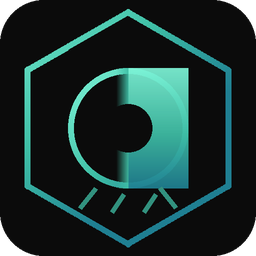
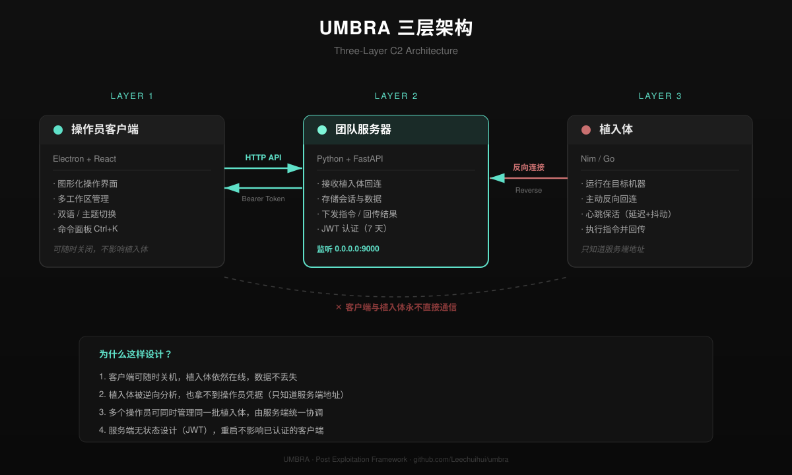

<p align="center">
  <a href="https://github.com/Leechuihui/umbra">
    
    <h3 style="font-size: 1.7rem;" align="center">UMBRA</h3>
  </a>
</p>
 
<p align="center">
  Post exploitation framework
</p>

<p align="center">
  **English** | [简体中文](README.zh-CN.md)
</p>

<p align="center">
  [](https://www.typescriptlang.org)
  [](https://python.org)
  [](LICENSE)
  [](https://github.com/Leechuihui/umbra)
</p>

---

## About

**UMBRA** is a post-exploitation framework for advanced Red Team operations, built around a modern Electron + React desktop client and a Python team server. It ships with a fully bilingual interface (English / Chinese) that can be switched at runtime.

> Original work by **Philippe**

---

## Highlights

| Feature | Description |
| --- | --- |
| **Bilingual UI** | Real-time switching between English and Chinese; language preference is remembered |
| **Themes** | 4 original palettes: Shadow Cyan / Ember Orange / Abyss Blue / Monochrome |
| **Dashboard** | Operations dashboard: sessions, listeners, servers, elevated-privilege ratio, OS distribution |
| **Notebook** | Engagement notes, locally persisted and searchable |
| **Command Palette** | `Ctrl+K` fuzzy search to reach any panel and action |
| **Armory** | +550 curated BOF and .NET tools |
| **Communication** | Custom C2, supports external platforms such as Telegram and Discord |
| **Runtime evasion** | Indirect syscalls, stack spoofing, sleep masking, AMSI/ETW patching |
| **Injections** | VirtualAlloc, section, and module stomping allocation modes |
| **LOTL** | +240 native Windows binaries integrated (LOLBAS) |
| **Static evasion** | PE customization (icons, version info, timestamps, sections) |
| **Implants** | Cross-platform: Windows / Linux / macOS (incl. ARM) |
| **AI** | DeepSeek and custom LLM agents integrated |
| **Reports** | Executed commands, IOCs, and compromised-host report export |

---

## Requirements

| Component | Version |
| --- | --- |
| Python | **3.13.5** (server) |
| Node.js | **20+** (client build) |
| OS | Linux (server) · Windows / macOS / Linux (client) |

> The server is designed to run on **Linux**. The desktop client runs on Windows, macOS and Linux.

---

## Installation

### Option A — One-command install (Linux)

```bash
git clone https://github.com/Leechuihui/umbra.git
cd umbra
sudo bash install.sh all
```

### Option B — Windows client

Run **as Administrator**:

```bat
install\windows.bat client
```

This installs Node.js + Python 3.13.5 if missing, builds the client, and creates a Start Menu shortcut.

### Option C — Manual build

```bash
# 1. Server dependencies
cd server
python -m venv venv
source venv/bin/activate      # Windows: venv\Scripts\activate
pip install -r requirements.txt

# 2. Client build
cd ../client/gui
npm install
npm run dist                  # produces dist/ installers
```

---

## Quick Start

### 1. Start the team server

```bash
# Create an operator key first
./umbra.py server key add admin

# Start the server (default 0.0.0.0:9000)
./umbra.py server start
```

Server listens on **`0.0.0.0:9000`** by default.

### 2. Launch the client

```bash
./umbra.py client start
```

Or launch the built app directly:
- Windows: `client/gui/dist/win-unpacked/umbra.exe`
- macOS: `client/gui/dist/mac/umbra.app`
- Linux: `client/gui/dist/umbra.AppImage`

### 3. Connect

1. Open the client → top bar **UMBRA → Servers**
2. Click **Add**, fill in:
   - **Host**: your server IP (e.g. `192.168.1.10`)
   - **Port**: `9000`
   - **Protocol**: `http` (or `https` if TLS enabled)
   - **Key**: the operator key from step 1
3. Click **Auth** → status turns green when connected

---

## CLI Reference

```
umbra.py <mode> <command> ...

MODES
    server                          Server mode
    client                          Client mode

COMMANDS
    help                            Show help
    version                         Show server + client version

    server start                    Start the team server
    client start                    Launch the desktop client

    server config list              List server configuration
    server config set <key> <value> Set a config value
    server config reset <key>       Reset a key to default
    server config load <file>       Load config from file
    server config create-tls        Generate self-signed cert + enable TLS

    server key list                 List operator keys
    server key add <name>           Create an operator key
    server key rem <name>           Remove an operator key

    server venv list                List installed Python packages
    server venv install <package>   Install a Python package
    server venv uninstall <package> Uninstall a Python package

    server db usage                 Show database information
    server db export <path>         Export database
    server db import <file>         Import database
```

### Common config keys

| Key | Default | Description |
| --- | --- | --- |
| `server.host` | `0.0.0.0` | Bind address |
| `server.port` | `9000` | Listen port |
| `server.tls.tls` | `false` | Enable TLS |
| `server.keys.jwt.duration` | `7d` | Operator session lifetime |
| `server.runtime.workers` | `4` | Worker processes |
| `server.runtime.limit_concurrency` | `100` | Max concurrent requests |

Example:

```bash
./umbra.py server config set server.port 8443
./umbra.py server config create-tls
```

---

## Client Guide

### Top bar menus

| Menu | Contents |
| --- | --- |
| **UMBRA** | Dashboard · Notebook · Servers · Listeners · Implants · Network · Agents · NukeScripts · Reports · IOCs · Queue · Event Log · Quit |
| **View** | Command Palette (`Ctrl+K`) · Full Screen · Zoom · DevTools |
| **Tabs** | Terminal · File Browser · Processes · Screenshot · Keystrokes · Credentials · Sessions · Attack Graph · AI Agent · File Server · NS Debugger |
| **Help** | Documentation · Feedback · License · About |

### Keyboard shortcuts

| Shortcut | Action |
| --- | --- |
| `Ctrl+K` | Command palette |
| `Alt+T` | Terminal |
| `Alt+F` | File browser |
| `Alt+R` | Processes |
| `Alt+S` | Sessions |
| `Alt+A` | AI Agent |
| `Alt+K` | Credentials |
| `Shift+S` | Servers panel |
| `Shift+L` | Listeners panel |
| `Shift+I` | Implants panel |
| `Shift+N` | Network panel |
| `Shift+Q` | Queue panel |
| `Shift+E` | Event log |
| `Ctrl+Shift+W` | New workspace tab |
| `Ctrl+W` | Close active panel |
| `F1` | Documentation |
| `F11` | Full screen |

### Language & theme

- **Language**: click the 🌐 icon in the top bar → English / Chinese
- **Theme**: click the 🎨 icon → 4 palettes

Both are persisted locally and restored on next launch.

---

## Documentation

Full guides live in [`docs/`](docs/):

| Document | Contents |
|---|---|
| [docs/KALI.md](docs/KALI.md) | **Kali-specific**: install, start, connect, listeners, implants, troubleshooting, uninstall |
| [docs/ARCHITECTURE.md](docs/ARCHITECTURE.md) | Why the three layers exist, auth design, C2 flow, evasion techniques, what you learn |
| [docs/USAGE.md](docs/USAGE.md) | Step-by-step install → first session, network scenarios, troubleshooting |
| [docs/WEBSERVER-PLAYBOOK.md](docs/WEBSERVER-PLAYBOOK.md) | **Webserver case playbook**: measured target facts, runnable code, a 55-minute video script, what UMBRA adds, what you learn |
| [docs/VIDEO-SCRIPT-WEBSERVER.md](docs/VIDEO-SCRIPT-WEBSERVER.md) | Real-scenario video script (shot-by-shot version) |
| [docs/VIDEO-SCRIPT-KALI.md](docs/VIDEO-SCRIPT-KALI.md) | **Kali walkthrough video script**: advantages → install → hands-on → what you learn |
| [docs/VIDEO-SCRIPT.md](docs/VIDEO-SCRIPT.md) | Full tutorial video script with shot list and recording checklist |

### Diagrams

SVG vector diagrams, ready for slides and video overlays:

| Diagram | File |
|---|---|
| Three-layer architecture | [01-architecture.svg](docs/diagrams/01-architecture.svg) |
| Network topology & port forwarding | [02-network-topology.svg](docs/diagrams/02-network-topology.svg) |
| C2 communication flow (8 steps) | [03-c2-flow.svg](docs/diagrams/03-c2-flow.svg) |
| Post-exploitation capabilities | [04-post-exploitation.svg](docs/diagrams/04-post-exploitation.svg) |
| Quick start (5 steps) | [05-quickstart.svg](docs/diagrams/05-quickstart.svg) |



---

## Project Structure

```
umbra/
├── umbra.py                 # CLI entrypoint
├── install/                 # Platform installers
│   ├── linux.sh
│   ├── mac.sh
│   └── windows.bat
├── client/gui/              # Electron + React desktop client
│   ├── electron/            # Main process
│   ├── src/
│   │   ├── components/      # UI components
│   │   ├── i18n/            # EN / Chinese dictionaries
│   │   ├── theme/           # Theme system
│   │   └── api/             # Server API clients
│   └── public/              # Icons
├── server/                  # Python team server
│   ├── core/                # FastAPI app + C2 logic
│   ├── launcher/            # CLI command handlers
│   └── infra/               # Database, listeners, builds
└── implants/                # Implant source (Nim / Go)
```

---

## Troubleshooting

**Client shows "Desktop app only"**
> The client must run through Electron. Use `npm run dev` or the packaged binary, not a browser.

**"No servers configured"**
> Add a server via **UMBRA → Servers → Add**, then click **Auth**.

**Server won't start on port 9000**
> Port already in use. Change it: `./umbra.py server config set server.port 8443`

**Build fails on `npm install`**
> Ensure Node.js 20+. Delete `node_modules` and `package-lock.json`, then retry.

**Icons look wrong after build**
> Regenerate: `python scripts/gen_icons.py` (inside `client/gui`)

---

## Credits & License

**Author**: Philippe

Licensed under **GPLv3** — see [LICENSE](LICENSE).

Third-party components:

- [SGN](server/infra/bin/encoders/sgn/) — MIT (Ege Balcı)
- [Nim crypt utils](implants/linux/stageless/utils/crypt/utils/) — MIT (Eugene Kabanov)
- [LOLBAS reference](server/core/utils/messages/lolbins/reference/LOLBAS/) — GPLv3 (upstream LOLBAS dataset)

---

## Disclaimer

This tool is intended **exclusively** for authorized security testing, CTF competitions, and educational research. You must have explicit written permission from the system owner before use. Unauthorized access to computer systems is illegal.
