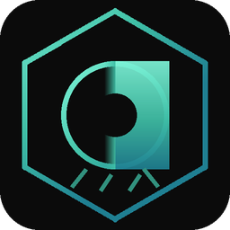
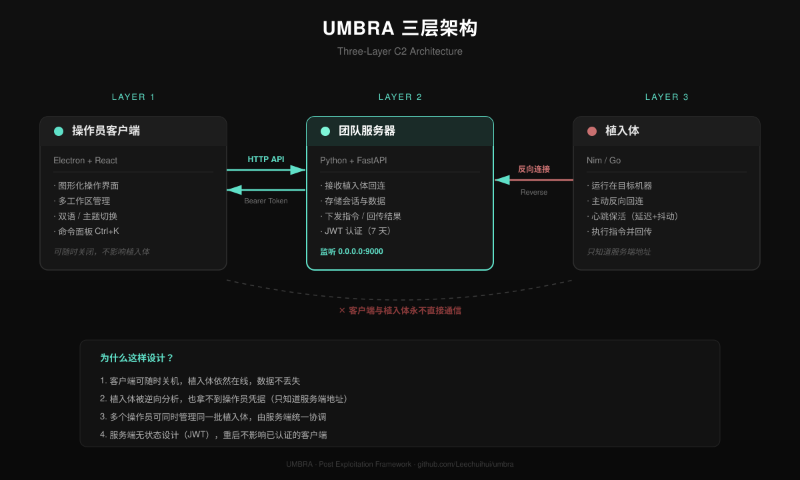

<p align="center">
  <a href="https://github.com/Leechuihui/umbra">
    
    <h3 style="font-size: 1.7rem;" align="center">UMBRA</h3>
  </a>
</p>

<p align="center">
  后渗透测试框架 · Post exploitation framework
</p>

<p align="center">
  <a href="README.md">English</a> · <b>简体中文</b>
</p>

---

## 简介

**UMBRA** 是一款面向高级红队行动的后渗透测试框架，由 Electron + React 桌面客户端与 Python 团队服务器组成，界面支持中英文实时切换。

> 本项目为 **Philippe** 原创作品

---

## 核心特性

| 功能 | 说明 |
| --- | --- |
| **双语界面** | 中英文实时切换，自动记忆语言偏好 |
| **主题系统** | 4 套原创配色：暗影青 / 余烬橙 / 深渊蓝 / 单色 |
| **作战仪表盘** | 会话、监听器、服务器、高权限占比、系统分布一览 |
| **作战笔记** | 本地持久化，支持搜索 |
| **命令面板** | `Ctrl+K` 模糊搜索直达任意面板与操作 |
| **军械库** | +550 个适配的 BOF 与 .NET 工具 |
| **通信** | 自定义 C2，支持 Telegram、Discord 等外部平台 |
| **运行时规避** | 间接系统调用、栈欺骗、睡眠掩码、AMSI/ETW 补丁 |
| **注入** | VirtualAlloc、section、module stomping 三种分配模式 |
| **LOTL** | 集成 +240 个原生 Windows 二进制（LOLBAS） |
| **静态规避** | PE 自定义（图标、版本信息、时间戳、节区） |
| **植入体** | 跨平台：Windows / Linux / macOS（含 ARM） |
| **AI** | 集成 DeepSeek 及自定义 LLM 智能体 |
| **报告** | 执行命令、IOC、失陷主机报告导出 |

---

## 环境要求

| 组件 | 版本 |
| --- | --- |
| Python | **3.13.5**（服务端） |
| Node.js | **20+**（客户端构建） |
| 系统 | Linux（服务端）· Windows / macOS / Linux（客户端） |

> 服务端建议运行在 **Linux**；桌面客户端支持 Windows / macOS / Linux。

---

## 安装

### 方式一 —— Linux 一键安装

```bash
git clone https://github.com/Leechuihui/umbra.git
cd umbra
sudo bash install.sh all
```

### 方式二 —— Windows 客户端

**以管理员身份**运行：

```bat
install\windows.bat client
```

脚本会自动安装 Node.js 与 Python 3.13.5（如缺失）、构建客户端并创建开始菜单快捷方式。

### 方式三 —— 手动构建

```bash
# 1. 服务端依赖
cd server
python -m venv venv
source venv/bin/activate      # Windows: venv\Scripts\activate
pip install -r requirements.txt

# 2. 客户端构建
cd ../client/gui
npm install
npm run dist                  # 生成 dist/ 安装包
```

---

## 快速开始

### 1. 启动团队服务器

```bash
# 先创建操作员密钥
./umbra.py server key add admin

# 启动服务器（默认 0.0.0.0:9000）
./umbra.py server start
```

服务端默认监听 **`0.0.0.0:9000`**。

### 2. 启动客户端

```bash
./umbra.py client start
```

或直接运行构建产物：
- Windows: `client/gui/dist/win-unpacked/umbra.exe`
- macOS: `client/gui/dist/mac/umbra.app`
- Linux: `client/gui/dist/umbra.AppImage`

### 3. 连接服务器

1. 打开客户端 → 顶栏 **UMBRA → 服务器**
2. 点击 **添加**，填写：
   - **主机**：服务器 IP（如 `192.168.1.10`）
   - **端口**：`9000`
   - **协议**：`http`（启用 TLS 则用 `https`）
   - **密钥**：第 1 步生成的操作员密钥
3. 点击 **认证** → 状态变绿即连接成功

---

## 命令参考

```
umbra.py <mode> <command> ...

模式
    server                          服务器模式
    client                          客户端模式

命令
    help                            显示帮助
    version                         显示服务端与客户端版本

    server start                    启动团队服务器
    client start                    启动桌面客户端

    server config list              列出服务器配置
    server config set <key> <value> 设置配置项
    server config reset <key>       重置为默认值
    server config load <file>       从文件加载配置
    server config create-tls        生成自签名证书并启用 TLS

    server key list                 列出操作员密钥
    server key add <name>           创建操作员密钥
    server key rem <name>           删除操作员密钥

    server venv list                列出已安装的 Python 包
    server venv install <package>   安装 Python 包
    server venv uninstall <package> 卸载 Python 包

    server db usage                 查看数据库信息
    server db export <path>         导出数据库
    server db import <file>         导入数据库
```

### 常用配置项

| 配置键 | 默认值 | 说明 |
| --- | --- | --- |
| `server.host` | `0.0.0.0` | 绑定地址 |
| `server.port` | `9000` | 监听端口 |
| `server.tls.tls` | `false` | 启用 TLS |
| `server.keys.jwt.duration` | `7d` | 操作员会话有效期 |
| `server.runtime.workers` | `4` | 工作进程数 |
| `server.runtime.limit_concurrency` | `100` | 最大并发请求 |

示例：

```bash
./umbra.py server config set server.port 8443
./umbra.py server config create-tls
```

---

## 客户端指南

### 顶栏菜单

| 菜单 | 内容 |
| --- | --- |
| **UMBRA** | 作战仪表盘 · 作战笔记 · 服务器 · 监听器 · 植入体 · 网络 · 智能体 · Nuke 脚本 · 报告 · IOC 指标 · 队列 · 事件日志 · 退出 |
| **视图** | 命令面板（`Ctrl+K`）· 全屏 · 缩放 · 开发者工具 |
| **标签页** | 终端 · 文件浏览器 · 进程 · 屏幕截图 · 键盘记录 · 凭据 · 会话 · 攻击图谱 · AI 智能体 · 文件服务器 · NS 调试器 |
| **帮助** | 文档 · 反馈 · 许可证 · 关于 |

### 快捷键

| 快捷键 | 功能 |
| --- | --- |
| `Ctrl+K` | 命令面板 |
| `Alt+T` | 终端 |
| `Alt+F` | 文件浏览器 |
| `Alt+R` | 进程 |
| `Alt+S` | 会话 |
| `Alt+A` | AI 智能体 |
| `Alt+K` | 凭据 |
| `Shift+S` | 服务器面板 |
| `Shift+L` | 监听器面板 |
| `Shift+I` | 植入体面板 |
| `Shift+N` | 网络面板 |
| `Shift+Q` | 队列面板 |
| `Shift+E` | 事件日志 |
| `Ctrl+Shift+W` | 新建工作区标签页 |
| `Ctrl+W` | 关闭当前面板 |
| `F1` | 文档 |
| `F11` | 全屏 |

### 语言与主题

- **语言**：点击顶栏 🌐 图标 → English / 中文
- **主题**：点击 🎨 图标 → 4 套配色

两者都会本地保存，下次启动自动恢复。

---

## 文档

完整指南在 [`docs/`](docs/) 目录：

| 文档 | 内容 |
|---|---|
| [docs/KALI.md](docs/KALI.md) | **Kali 专用**：安装、启动、连接、监听器、植入体、排错、卸载 |
| [docs/ARCHITECTURE.md](docs/ARCHITECTURE.md) | 三层架构为什么这样设计、认证机制、C2 通信流程、隐蔽性技术、能学到什么 |
| [docs/USAGE.md](docs/USAGE.md) | 从安装到首个会话的完整步骤、网络场景专题、排错手册 |
| [docs/WEBSERVER-PLAYBOOK.md](docs/WEBSERVER-PLAYBOOK.md) | **实战作战手册**：靶机实测事实、完整执行代码、55 分钟视频脚本、UMBRA 价值、学习路径 |
| [docs/VIDEO-SCRIPT-WEBSERVER.md](docs/VIDEO-SCRIPT-WEBSERVER.md) | 实战场景视频脚本（分镜版） |
| [docs/VIDEO-SCRIPT-KALI.md](docs/VIDEO-SCRIPT-KALI.md) | **Kali 实战视频脚本**：优势介绍 → 安装 → 实战 → 学到了什么，一条线讲透 |
| [docs/VIDEO-SCRIPT.md](docs/VIDEO-SCRIPT.md) | 完整视频教程分镜脚本 + 录制清单 |

### 架构图

SVG 矢量图，可直接用于 PPT 和视频叠加：

| 图 | 文件 |
|---|---|
| 三层架构 | [01-architecture.svg](docs/diagrams/01-architecture.svg) |
| 网络拓扑与端口转发 | [02-network-topology.svg](docs/diagrams/02-network-topology.svg) |
| C2 通信流程（8 步） | [03-c2-flow.svg](docs/diagrams/03-c2-flow.svg) |
| 后渗透能力全景 | [04-post-exploitation.svg](docs/diagrams/04-post-exploitation.svg) |
| 快速开始（5 步） | [05-quickstart.svg](docs/diagrams/05-quickstart.svg) |



---

## 项目结构

```
umbra/
├── umbra.py                 # 命令行入口
├── install/                 # 各平台安装脚本
│   ├── linux.sh
│   ├── mac.sh
│   └── windows.bat
├── client/gui/              # Electron + React 桌面客户端
│   ├── electron/            # 主进程
│   ├── src/
│   │   ├── components/      # UI 组件
│   │   ├── i18n/            # 中英文字典
│   │   ├── theme/           # 主题系统
│   │   └── api/             # 服务端 API 封装
│   └── public/              # 图标
├── server/                  # Python 团队服务器
│   ├── core/                # FastAPI 应用 + C2 逻辑
│   ├── launcher/            # 命令行处理器
│   └── infra/               # 数据库、监听器、构建产物
└── implants/                # 植入体源码（Nim / Go）
```

---

## 常见问题

**客户端显示「仅限桌面应用」**
> 客户端必须通过 Electron 运行。请使用 `npm run dev` 或打包后的可执行文件，不要用浏览器打开。

**提示「尚未配置服务器」**
> 通过 **UMBRA → 服务器 → 添加** 配置，然后点击 **认证**。

**9000 端口启动失败**
> 端口被占用。修改端口：`./umbra.py server config set server.port 8443`

**`npm install` 构建失败**
> 确认 Node.js 20+。删除 `node_modules` 和 `package-lock.json` 后重试。

**构建后图标不对**
> 重新生成：在 `client/gui` 目录下运行 `python scripts/gen_icons.py`

---

## 致谢与许可

**作者**：Philippe

基于 **GPLv3** 许可 —— 详见 [LICENSE](LICENSE)。

第三方组件：

- [SGN](server/infra/bin/encoders/sgn/) —— MIT（Ege Balcı）
- [Nim crypt utils](implants/linux/stageless/utils/crypt/utils/) —— MIT（Eugene Kabanov）
- [LOLBAS reference](server/core/utils/messages/lolbins/reference/LOLBAS/) —— GPLv3（上游 LOLBAS 数据集）

---

## 免责声明

本工具**仅供**授权安全测试、CTF 竞赛与教学研究使用。使用前必须获得目标系统所有者的明确书面授权。未经授权访问计算机系统属于违法行为。
