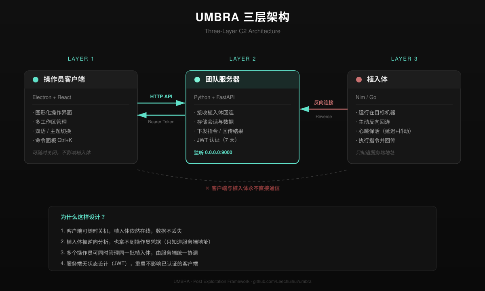
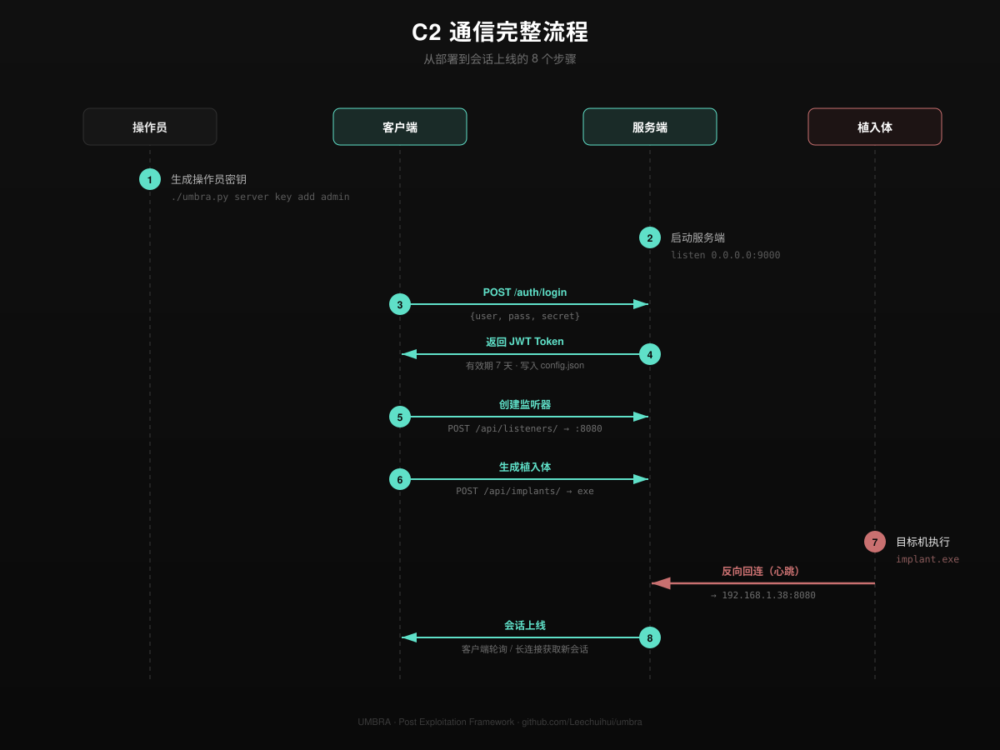

# UMBRA 架构详解

> 本文解释 UMBRA 的设计原理。理解这些，你才能明白每个操作背后的原因，而不是照抄步骤。

---

## 目录

1. [项目定位](#1-项目定位)
2. [三层架构](#2-三层架构)
3. [为什么这样设计](#3-为什么这样设计)
4. [认证机制](#4-认证机制)
5. [监听器与植入体的关系](#5-监听器与植入体的关系)
6. [C2 通信完整流程](#6-c2-通信完整流程)
7. [隐蔽性设计](#7-隐蔽性设计)
8. [技术栈总览](#8-技术栈总览)
9. [能学到什么](#9-能学到什么)

---

## 1. 项目定位

UMBRA 是一个**后渗透测试框架**（Post-Exploitation Framework），俗称 C2 框架。

### 它解决什么问题

假设你在一次授权测试中，已经通过某个漏洞拿到了目标机器的一个 shell。接下来你要做的是：

- 稳定地保持这个访问权限
- 在目标上执行各种命令
- 收集凭据、文件、情报
- 以这台机器为跳板，进入它所在的内网
- 最后产出一份可交付的报告

**如果只有裸 shell，这些事都要手工做，效率极低且容易丢失访问。**

C2 框架就是把这些重复工作工程化：会话管理、命令下发、结果回传、文件传输、凭据管理、报告生成，全部集成到一个界面里。

### 它不是什么

- ❌ **不是漏洞利用工具**。UMBRA 不负责"打进去"，它负责"打进去之后做什么"。初始访问需要你自己通过其他手段获得。
- ❌ **不是免杀神器**。它提供了一些规避技术，但不保证绕过任何特定杀软。
- ❌ **不是自动化攻击平台**。所有操作都需要操作员决策。

---

## 2. 三层架构



### 2.1 操作员客户端（Client）

**技术栈**：Electron 44 + React 19 + Vite 8 + Tailwind v4

**职责**：
- 提供图形化操作界面
- 管理多个团队服务器连接
- 展示会话、监听器、植入体、报告等数据
- 通过 HTTP API 与服务端通信

**关键特性**：
- 双语界面（中文 / English），实时切换，选择持久化到 localStorage
- 4 套主题（暗影青 / 余烬橙 / 深渊蓝 / 单色），基于 CSS 自定义属性实现
- 命令面板（`Ctrl+K`），模糊搜索所有功能
- 多工作区，可同时管理多个测试项目

**重要**：客户端可以随时关闭。关闭后植入体依然在线，数据依然保存在服务端。下次打开客户端，会话还在。

### 2.2 团队服务器（Team Server）

**技术栈**：Python 3.10+ + FastAPI + uvicorn + SQLAlchemy 2.0 + SQLite

**职责**：
- 接收植入体的反向回连
- 存储所有数据（会话、命令历史、凭据、IOC）
- 给客户端提供 REST API
- 编译植入体
- 管理监听器

**默认配置**：
| 项目 | 值 |
|---|---|
| 监听地址 | `0.0.0.0:9000` |
| 数据库 | SQLite（`server/infra/database/database.db`） |
| JWT 有效期 | 10080 分钟（7 天） |
| 认证端点 | `POST /auth/login` |

**启动流程**：
```
1. 加载配置
2. 启动 SQLite 数据库
3. 启动 NukeScripts worker（脚本引擎）
4. 启动 uvicorn，监听 9000
```

### 2.3 植入体（Implant）

**技术栈**：Nim（Windows）/ Go（Linux、macOS）

**职责**：
- 运行在目标机器上
- 主动反向回连服务端
- 定期发送心跳保活
- 接收并执行指令
- 回传执行结果

**关键特性**：
- 只知道服务端地址，不知道操作员信息
- 支持延迟 + 抖动的心跳策略
- 支持运行时规避（AMSI patch、ETW patch、睡眠掩码）
- 两种形态：Stageless（单文件）/ Loader（两阶段）

---

## 3. 为什么这样设计

### 3.1 客户端与植入体永不直接通信

这是整个架构最重要的约束。

```
✅ 正确：Client ←→ Server ←→ Implant
❌ 错误：Client ←→ Implant
```

**四个原因**：

**① 客户端可以离线**
操作员关掉电脑，植入体依然按时回连服务端，数据不丢。下次打开客户端，历史记录都在。

**② 植入体被分析也拿不到操作员信息**
植入体里只有服务端地址。攻击者逆向分析植入体，最多找到 C2 服务器，找不到操作员的 IP、凭据、其他目标信息。

**③ 支持多人协作**
多个操作员可以同时连接同一个服务端，管理同一批植入体。服务端做协调和权限控制。

**④ 服务端无状态**
JWT 认证意味着服务端不需要存储会话状态。重启服务端不影响已认证的客户端（只要 token 没过期）。

### 3.2 为什么要有"监听器"这一层

初学者常问：服务端已经在 9000 端口监听了，为什么还要单独建一个 8080 的监听器？

**因为职责不同**：

| 组件 | 端口 | 面向谁 | 协议 |
|---|---|---|---|
| 服务端 API | 9000 | 操作员客户端 | HTTP REST |
| 监听器 | 8080（可自定义） | 植入体 | HTTP / HTTPS / SMB / TCP |

**一个服务端可以挂多个监听器**。比如：

```
服务端 :9000
├── 监听器 A :8080  (HTTP)   → 用于能出网的 Windows 目标
├── 监听器 B :8443  (HTTPS)  → 用于有流量检测的环境
├── 监听器 C :445   (SMB)    → 用于纯内网横向
└── 监听器 D :1080  (TCP)    → 用于直连场景
```

不同网络环境用不同通道，这是 C2 框架灵活性的核心。

---

## 4. 认证机制

### 4.1 三段式密钥

创建操作员时，服务端生成一行三段式密钥：

```
admin:CjzeeStPQ9wfCnyH5iwHKzK:BtdxBz5pYq4fcOpFefvwwlmgIrO5...
  ↑            ↑                        ↑
用户名        密码                    密钥(secret)
```

**为什么是三段？**

这是**双因素认证**的设计：

| 段位 | 类型 | 验证方式 | 泄露后果 |
|---|---|---|---|
| 用户名 | 标识 | 数据库查询 | 无（只是名字） |
| 密码 | 你知道什么 | bcrypt 哈希比对 | 需配合 secret 才能用 |
| 密钥 | 你持有什么 | 明文比对 | 需配合密码才能用 |

**关键点**：服务端存的是密码的 **bcrypt 哈希**，不是明文。即使数据库被拖走，攻击者也拿不到明文密码。而 secret 是明文存储的，所以它必须足够长（UMBRA 生成的是 128 字符）。

### 4.2 认证流程

```
客户端                                    服务端
  │                                         │
  │  POST /auth/login                       │
  │  {user, pass, secret}                   │
  ├────────────────────────────────────────►│
  │                                         │ 1. 查数据库找 user
  │                                         │ 2. 比对 secret（明文）
  │                                         │ 3. bcrypt 校验 pass
  │                                         │ 4. 签发 JWT
  │  {status: success, access_token: ...}   │
  │◄────────────────────────────────────────┤
  │                                         │
  │  后续请求带 Authorization: Bearer xxx    │
  ├────────────────────────────────────────►│
  │                                         │ 中间件验证 JWT
  │                                         │ 检查 sub 用户是否还存在
```

### 4.3 JWT 中间件

服务端每个请求（除 `/auth/login` 和 OPTIONS）都经过 JWT 中间件：

```python
# server/core/middlewares/jwt.py 核心逻辑
if request.method == "OPTIONS" or request.url.path == "/auth/login":
    return await call_next(request)          # 放行

token = auth[7:].strip() if auth.startswith("Bearer ") else ""
try:
    if not token:
        raise InvalidTokenError
    payload = jwt.decode(token, jwt_secret, algorithms=["HS256"])
    sub = str(payload.get("sub") or "").strip()
    if not sub or not await sqlite_db.read(User, user=sub):
        raise InvalidTokenError              # 用户被删了也要失效
except InvalidTokenError:
    return JSONResponse(401, {"message": "Expired session"})
```

**注意最后一步**：不仅验证签名和过期时间，还检查用户是否还存在。删除操作员后，他手上的 token 立即失效。

### 4.4 客户端配置存储

认证成功后，客户端把服务器信息写入：

```
Linux:   ~/.config/umbra/config.json
Windows: %APPDATA%\umbra\config.json
macOS:   ~/Library/Application Support/umbra/config.json
```

内容：
```json
{
  "servers": [
    {
      "id": "唯一标识",
      "name": "kali-lab",
      "ip": "http://127.0.0.1",
      "port": "9000",
      "user": "admin",
      "pass": "...",
      "secret": "...",
      "token": "eyJhbGciOiJIUzI1NiIs..."
    }
  ]
}
```

**这个文件就是监听器面板"服务器下拉框"的数据源。** 如果 `servers` 是空数组，下拉框就没有任何选项——这是新手最常见的困惑点。

> **设计说明**：服务器配置只有在**认证成功**后才写入。只填表单不点认证，不会保存。

---

## 5. 监听器与植入体的关系

### 5.1 概念对应

| 监听器字段 | 含义 | 植入体对应字段 |
|---|---|---|
| `channelPayload` | 通信协议（http/https） | C2 通道 |
| `portToOpen` | 监听端口（如 8080） | C2 端口 |
| `host` | 绑定地址（通常 0.0.0.0） | — |
| 所在服务器 | 由哪台服务端管理 | C2 服务器地址 |

### 5.2 生命周期

```
1. 操作员创建监听器
   → 服务端在指定端口启动监听
   → 数据库记录监听器配置

2. 操作员生成植入体
   → 植入体被编译进 C2 地址（host:port）
   → 植入体只知道"连哪里"，不知道"谁在连"

3. 目标执行植入体
   → 植入体按 C2 地址发起连接
   → 监听器接收，建立会话
   → 写入数据库，客户端可见

4. 操作员下发指令
   → 客户端 → 服务端 → 监听器 → 植入体
   → 植入体执行 → 结果原路返回

5. 操作员删除监听器
   → 端口释放
   → 已有会话可能断开（取决于实现）
```

### 5.3 通道类型对比

| 通道 | 端口 | 优点 | 缺点 | 适用场景 |
|---|---|---|---|---|
| HTTP | 80/8080/自定义 | 混在正常 Web 流量中，最不易被拦 | 有 HTTP 头开销 | 通用，首选 |
| HTTPS | 443/8443 | 加密，抗流量分析 | 需要证书 | 有 IDS/DPI 的环境 |
| SMB | 445 | 内网天然开放，不触发出网告警 | 仅限内网 | 纯内网横向 |
| TCP | 自定义 | 速度快，开销小 | 特征明显，易被检测 | 直连、低延迟场景 |

---

## 6. C2 通信完整流程



### 详细步骤

**步骤 1 · 生成操作员密钥**
```bash
./umbra.py server key add admin
```
服务端生成三段式密钥，密码做 bcrypt 哈希后存库，密钥明文存库。

**步骤 2 · 启动服务端**
```bash
./umbra.py server start
```
uvicorn 监听 `0.0.0.0:9000`，加载 JWT 中间件。

**步骤 3 · 客户端登录**
```
POST http://127.0.0.1:9000/auth/login
{"user":"admin","pass":"...","secret":"..."}
```

**步骤 4 · 服务端返回 JWT**
```json
{"status":"success","access_token":"eyJhbGci..."}
```
客户端把 token 和服务器信息一起写入 `config.json`。

**步骤 5 · 创建监听器**
```
POST /api/listeners/
Authorization: Bearer <token>
{
  "name": "http-8080",
  "listenerType": "channel",
  "channelPayload": "http",
  "host": "0.0.0.0",
  "port": "8080",
  "portToOpen": 8080
}
```
服务端在 8080 启动监听。

**步骤 6 · 生成植入体**
```
POST /api/implants/
Authorization: Bearer <token>
{
  "name": "demo",
  "os": "windows",
  "arch": "x64",
  "format": "exe",
  "channel": "http",
  "c2Host": "192.168.1.38",
  "c2Port": "8080",
  "delay": 5,
  "jitter": 20
}
```
服务端编译出 exe，其中硬编码了 C2 地址。

**步骤 7 · 目标执行，反向回连**
```
植入体 → 192.168.1.38:8080（宿主机）
       → VirtualBox NAT 转发
       → Kali:8080（监听器）
```
植入体按 `delay ± jitter` 的间隔发送心跳。

**步骤 8 · 会话上线**
监听器收到连接，创建会话记录，客户端轮询/长连接获取到新会话。

---

## 7. 隐蔽性设计

### 7.1 心跳延迟与抖动

**问题**：如果植入体每 5 秒精确回连一次，流量分析一眼就能看出异常——人类不会这么规律。

**方案**：
```
实际间隔 = delay × (1 ± jitter/100) 的随机值
```

例：`delay=5, jitter=20` → 间隔在 4.0–6.0 秒之间随机。

**效果**：流量看起来像正常用户行为，而不是机器定时任务。

### 7.2 睡眠掩码（Sleep Mask）

**问题**：植入体休眠时，内存里的恶意代码是明文，容易被 EDR 的内存扫描发现。

**方案**：
```
休眠前：加密内存中的代码和数据
休眠中：内存里是乱码，扫描器看不到特征
醒来后：解密，继续执行
```

常见实现（Ekko、Zilean）利用 Windows 定时器回调（`CreateTimerQueueTimer`）在休眠期间完成加解密。

### 7.3 AMSI / ETW Patch

| 技术 | 对抗什么 | 原理 |
|---|---|---|
| AMSI patch | PowerShell 恶意脚本检测 | 修改 AMSI 的扫描函数，让它永远返回"干净" |
| ETW patch | Windows 事件追踪 | 修改 ETW 回调，阻止安全产品收到进程行为事件 |

### 7.4 Shellcode 编码（SGN）

SGN（Shikata Ga Nai）是一个多态编码器。同一段 shellcode 每次编码后：

- 字节序列不同
- 解码器（stub）也不同
- 但执行效果相同

**效果**：基于静态特征签名的杀软无法通过固定字节匹配来识别。

### 7.5 重要提醒

> **这些技术不保证绕过任何特定杀软。** 现代 EDR 使用行为分析、内存扫描、云查杀等多层检测。规避是一个持续对抗的过程，不是一次性配置。

---

## 8. 技术栈总览

### 客户端

| 组件 | 版本 | 用途 |
|---|---|---|
| Electron | 44 | 桌面容器 |
| React | 19 | UI 框架 |
| Vite | 8 | 构建工具 |
| electron-vite | 6 | Electron 专用构建 |
| Tailwind CSS | 4 | 样式 |
| Radix UI | — | 无障碍组件原语 |
| TypeScript | 5.9 | 类型系统 |

### 服务端

| 组件 | 版本 | 用途 |
|---|---|---|
| Python | 3.10+（推荐 3.13） | 运行时 |
| FastAPI | 0.120 | Web 框架 |
| uvicorn | 0.38 | ASGI 服务器 |
| SQLAlchemy | 2.0 | ORM |
| SQLite | — | 数据库 |
| pydantic | 2.12 | 数据校验 |
| PyJWT | 2.10 | JWT 签发/验证 |
| bcrypt | 5.0 | 密码哈希 |
| cryptography | 46 | 加密原语 |

### 植入体

| 平台 | 语言 | 说明 |
|---|---|---|
| Windows | Nim | 跨平台编译，PE 定制 |
| Linux | Go | 静态链接，无依赖 |
| macOS | Go | 支持 arm64 / x64 |

### 辅助工具

| 工具 | 用途 |
|---|---|
| SGN（Rust） | Shellcode 多态编码 |
| pproxy | 代理转发 |
| weasyprint | PDF 报告生成 |

---

## 9. 能学到什么

看完这套文档和视频，你应该掌握以下内容。

### 9.1 概念层

| 知识点 | 掌握标准 |
|---|---|
| C2 三层架构 | 能画出架构图，解释每层职责 |
| 为什么客户端不直连植入体 | 能说出至少 3 个原因 |
| 监听器 vs 服务端 | 能说清两者端口和面向对象的不同 |
| 反向连接 | 理解为什么植入体要主动连出 |
| 双因素认证 | 能解释三段式密钥每一段的作用 |

### 9.2 原理层

| 知识点 | 掌握标准 |
|---|---|
| NAT 与回连失败 | 能解释为什么目标连不上 `10.0.2.15` |
| 端口转发 | 能自己写出 `natpf1` 命令并验证 |
| 心跳延迟与抖动 | 能解释为什么需要随机化 |
| 睡眠掩码 | 能说清对抗的是什么检测 |
| JWT 无状态认证 | 理解为什么服务端重启不影响客户端 |
| bcrypt 哈希 | 理解为什么数据库泄露不等于密码泄露 |

### 9.3 实操层

| 技能 | 掌握标准 |
|---|---|
| 部署 C2 环境 | 能从零跑通 `install.sh all` |
| 创建操作员 | 能生成并正确使用三段式密钥 |
| 连接服务器 | 能完成认证并验证 config.json |
| 创建监听器 | 能选择合适通道并验证端口绑定 |
| 生成植入体 | 能根据目标环境选择参数 |
| 会话操作 | 能熟练使用终端、文件、进程、凭据面板 |
| 横向移动 | 能配置 SOCKS 代理访问内网 |
| 报告导出 | 能生成 PDF 报告 |

### 9.4 思维层

| 能力 | 说明 |
|---|---|
| **排错方法论** | 会话不上线时，能按"网络 → 端口 → 配置 → 载荷"顺序排查 |
| **工程健壮性** | 从安装脚本的 t64 兼容、tmpfs 处理，理解真实环境的复杂性 |
| **顺序依赖意识** | 理解"服务端 → 认证 → 监听器 → 植入体"的顺序不能颠倒 |
| **合规意识** | 明确知道授权边界在哪里，什么绝对不能做 |

### 9.5 延伸方向

掌握基础后，可以继续深入：

| 方向 | 内容 |
|---|---|
| **免杀对抗** | AMSI/ETW 绕过原理、PE 结构、编码器实现 |
| **内网渗透** | 域渗透、Kerberos 攻击、凭据传递 |
| **C2 开发** | 自定义通信协议、插件系统、流量伪装 |
| **蓝队检测** | 如何从流量、内存、日志中发现 C2 活动 |

---

## 附录：关键参数速查

| 项目 | 默认值 | 位置 |
|---|---|---|
| 服务端端口 | 9000 | `server/launcher/utils/config.py` |
| JWT 有效期 | 10080 分钟（7 天） | 同上 |
| 数据库 | SQLite | `server/infra/database/database.db` |
| 客户端配置 | `~/.config/umbra/config.json` | Linux |
| 认证端点 | `POST /auth/login` | `server/core/routes/auth.py` |
| 默认监听地址 | `0.0.0.0` | — |

---

*UMBRA · Post Exploitation Framework · [github.com/Leechuihui/umbra](https://github.com/Leechuihui/umbra)*
