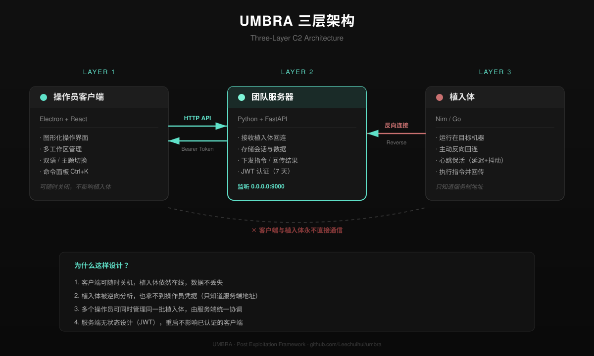
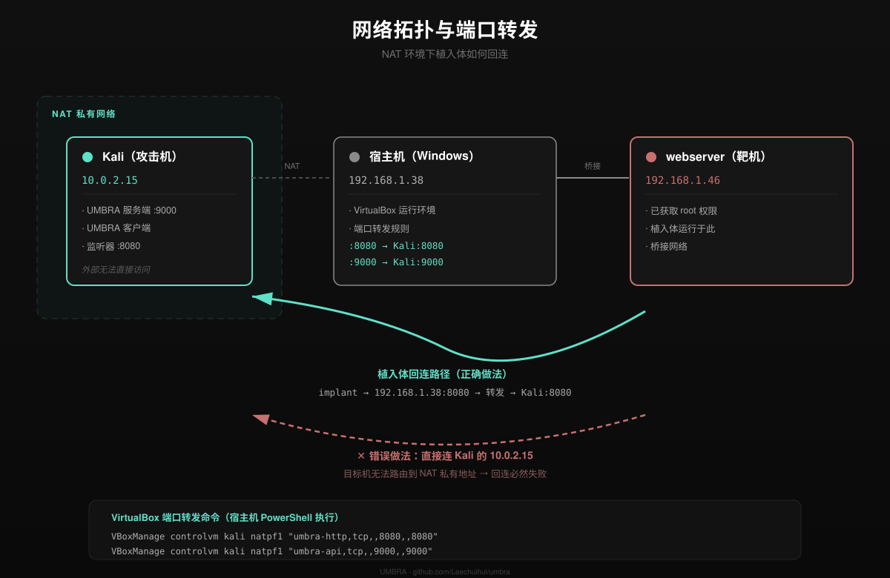
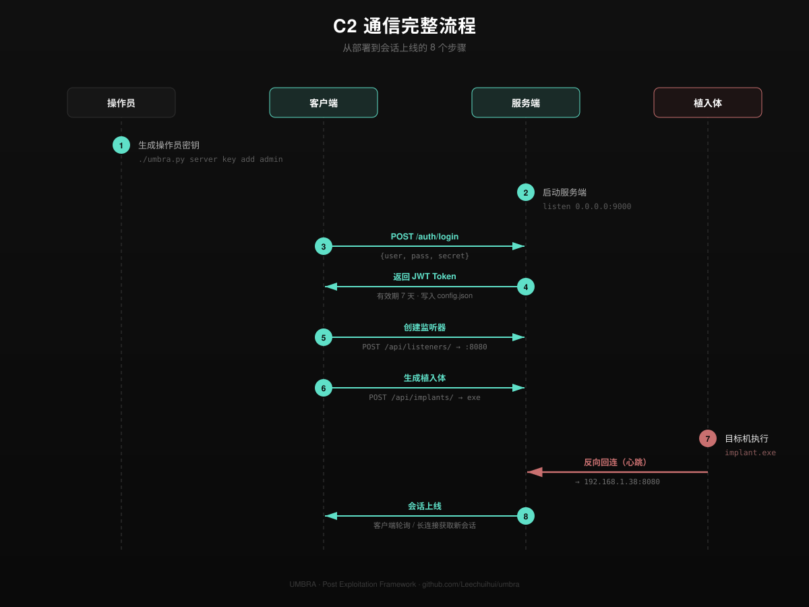
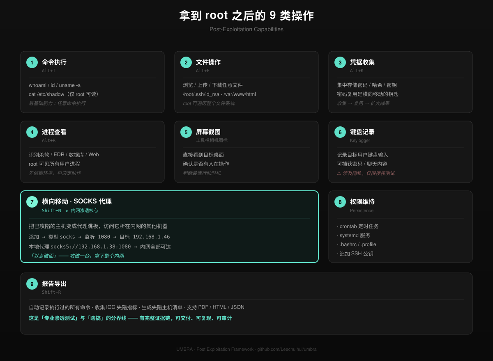
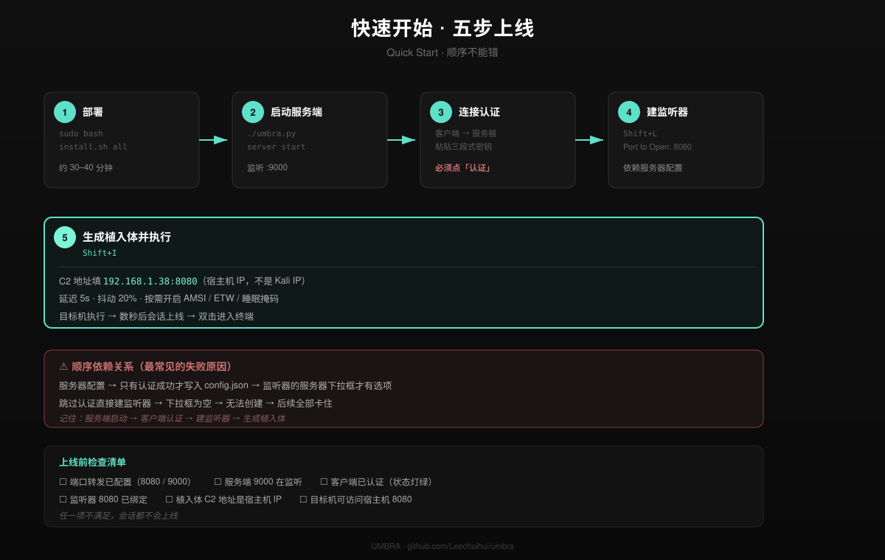

# UMBRA 文档中心

> 从架构原理到实战操作，从视频脚本到排错手册。

---

## 文档导航

| 文档 | 内容 | 适合谁 |
|---|---|---|
| [KALI.md](KALI.md) | **Kali 专用**：安装、启动、连接、监听器、植入体、排错、卸载 | 在 Kali 上使用的人 |
| [ARCHITECTURE.md](ARCHITECTURE.md) | 架构原理、设计思路、技术栈、能学到什么 | 想理解"为什么"的人 |
| [USAGE.md](USAGE.md) | 从安装到实战的完整操作手册 + 排错 | 想上手操作的人 |
| [VIDEO-SCRIPT-KALI.md](VIDEO-SCRIPT-KALI.md) | **Kali 实战视频脚本**：优势介绍 → 安装 → 实战 → 学到了什么，一条线讲透 | 做 Kali 教程视频的人 |
| [VIDEO-SCRIPT.md](VIDEO-SCRIPT.md) | 通用视频分镜脚本 + 录制清单 | 做通用教程视频的人 |

---

## 架构图

全部为 SVG 矢量图，可无损缩放，可直接放进视频或 PPT。

| 图 | 文件 | 用途 |
|---|---|---|
| 三层架构 | [01-architecture.svg](diagrams/01-architecture.svg) | 讲清客户端 / 服务端 / 植入体的关系 |
| 网络拓扑 | [02-network-topology.svg](diagrams/02-network-topology.svg) | 讲清 NAT 回连问题与端口转发 |
| C2 通信流程 | [03-c2-flow.svg](diagrams/03-c2-flow.svg) | 8 步时序图，从部署到会话上线 |
| 后渗透能力 | [04-post-exploitation.svg](diagrams/04-post-exploitation.svg) | root 权限下的 9 类操作 |
| 快速开始 | [05-quickstart.svg](diagrams/05-quickstart.svg) | 五步上线 + 检查清单 |

### 预览

**三层架构**



**网络拓扑**



**C2 通信流程**



**后渗透能力**



**快速开始**



---

## 五分钟速览

### UMBRA 是什么

一个后渗透测试框架（C2 框架）。它不负责"打进去"，负责"打进去之后做什么"——会话管理、命令下发、文件传输、凭据收集、横向移动、报告生成。

### 三层架构

```
操作员客户端  ←HTTP→  团队服务器  ←反向连接→  植入体
 (Electron)           (Python)              (Nim/Go)
```

**关键设计**：客户端与植入体永不直接通信。这样客户端可离线、植入体被分析也拿不到操作员信息。

### 五步上线

```bash
1. sudo bash install.sh all          # 部署
2. ./umbra.py server start           # 启动服务端
3. 客户端 → 服务器 → 添加 → 点「认证」  # 连接（必须点认证！）
4. Shift+L → 建监听器 :8080          # 监听器
5. Shift+I → C2 地址填宿主机 IP → Build # 生成植入体
```

### 最容易踩的三个坑

| 坑 | 现象 | 原因 | 解决 |
|---|---|---|---|
| **NAT 回连失败** | 会话永不上线 | C2 地址填了 NAT 私有 IP | 填宿主机 IP + 配端口转发 |
| **跳过认证** | 监听器服务器下拉框为空 | 服务器配置只在认证成功后保存 | 必须点「认证」 |
| **tmpfs 空间不足** | 安装报 `ENOSPC` | `/tmp` 是内存盘 | 脚本已自动重定向 TMPDIR |

---

## 能学到什么

### 概念层

- C2 框架为什么分三层，每层解决什么问题
- 为什么客户端不能直连植入体
- 监听器与服务端的职责区别
- 反向连接 vs 正向连接的取舍

### 原理层

- NAT 为什么导致回连失败
- 端口转发如何解决
- 心跳延迟与抖动为什么必须随机化
- 睡眠掩码对抗的是什么检测
- JWT 无状态认证的利弊
- bcrypt 哈希为什么能保护密码

### 实操层

- 从零部署一套完整 C2 环境
- 生成并正确使用三段式密钥
- 创建监听器并验证端口绑定
- 根据目标环境配置植入体参数
- 会话操作：终端、文件、进程、凭据
- SOCKS 代理横向移动
- 导出专业报告

### 思维层

- **排错方法论**：会话不上线时按"网络 → 端口 → 配置 → 载荷"顺序排查
- **工程健壮性**：从安装脚本的 t64 兼容、tmpfs 处理理解真实环境的复杂性
- **顺序依赖意识**：服务端 → 认证 → 监听器 → 植入体，顺序不能颠倒
- **合规意识**：明确授权边界

---

## 技术栈

| 层 | 技术 |
|---|---|
| 客户端 | Electron 44 · React 19 · Vite 8 · Tailwind v4 · TypeScript 5.9 |
| 服务端 | Python 3.10+ · FastAPI 0.120 · uvicorn 0.38 · SQLAlchemy 2.0 · SQLite |
| 植入体 | Nim（Windows）· Go（Linux / macOS） |
| 辅助 | SGN（Rust 编码器）· pproxy · weasyprint |

---

## 关键参数速查

| 项目 | 默认值 |
|---|---|
| 服务端端口 | `9000` |
| JWT 有效期 | 10080 分钟（7 天） |
| 数据库 | SQLite `server/infra/database/database.db` |
| 客户端配置 | `~/.config/umbra/config.json`（Linux） |
| 认证端点 | `POST /auth/login` |
| 默认监听地址 | `0.0.0.0` |

---

## 免责声明

> **UMBRA 仅用于授权的安全测试、CTF 竞赛与教学研究。**
>
> 使用前必须获得目标系统所有者的**明确书面授权**。
>
> 未经授权访问计算机系统，违反《中华人民共和国刑法》第 285 条（非法侵入计算机信息系统罪），最高可判七年。
>
> 使用者需自行承担全部法律责任。作者不对任何滥用行为负责。

---

*UMBRA · Post Exploitation Framework · [github.com/Leechuihui/umbra](https://github.com/Leechuihui/umbra)*
